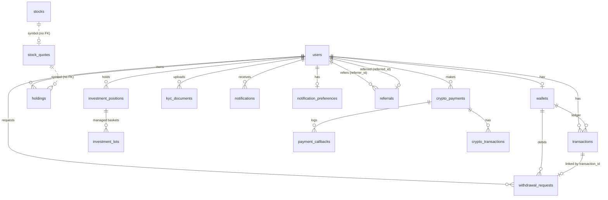
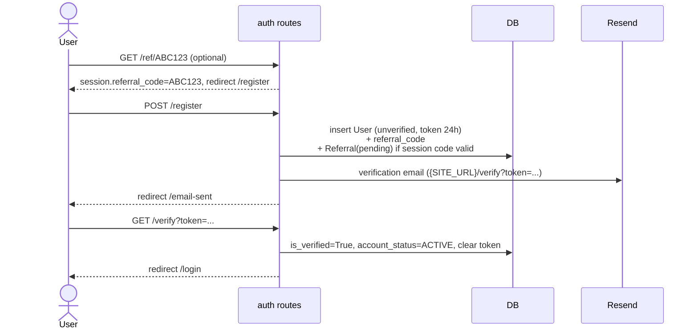
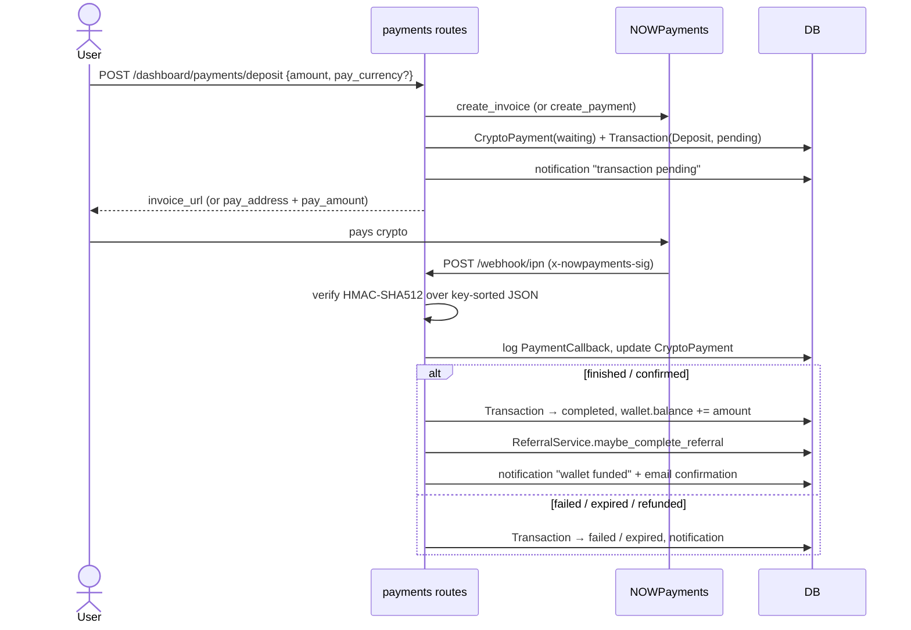
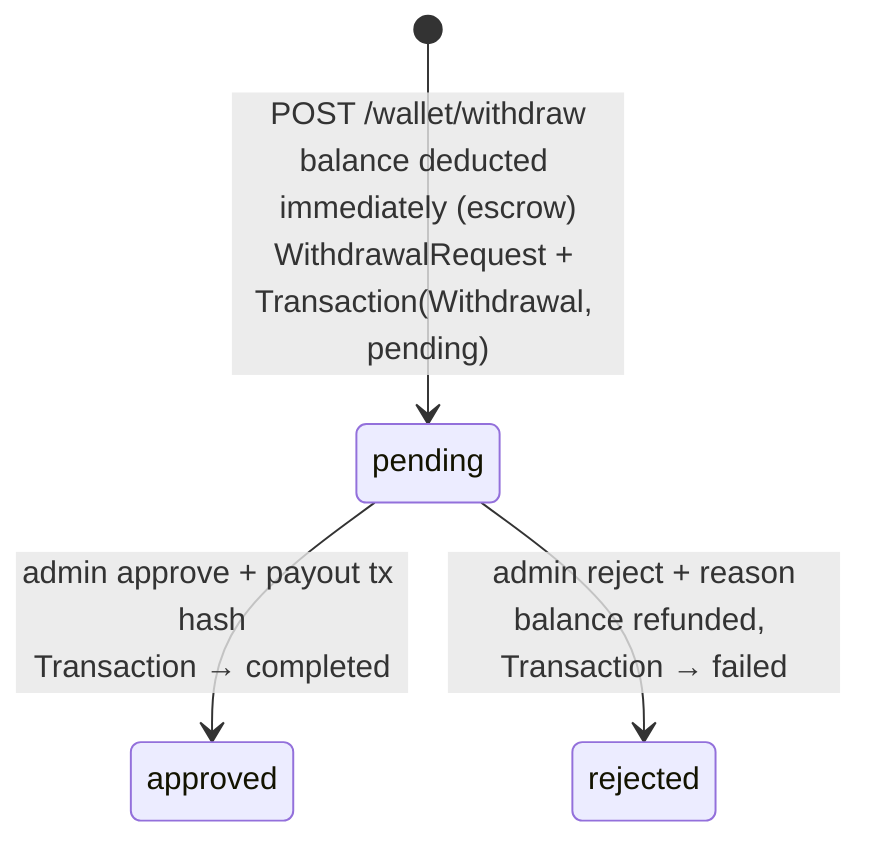
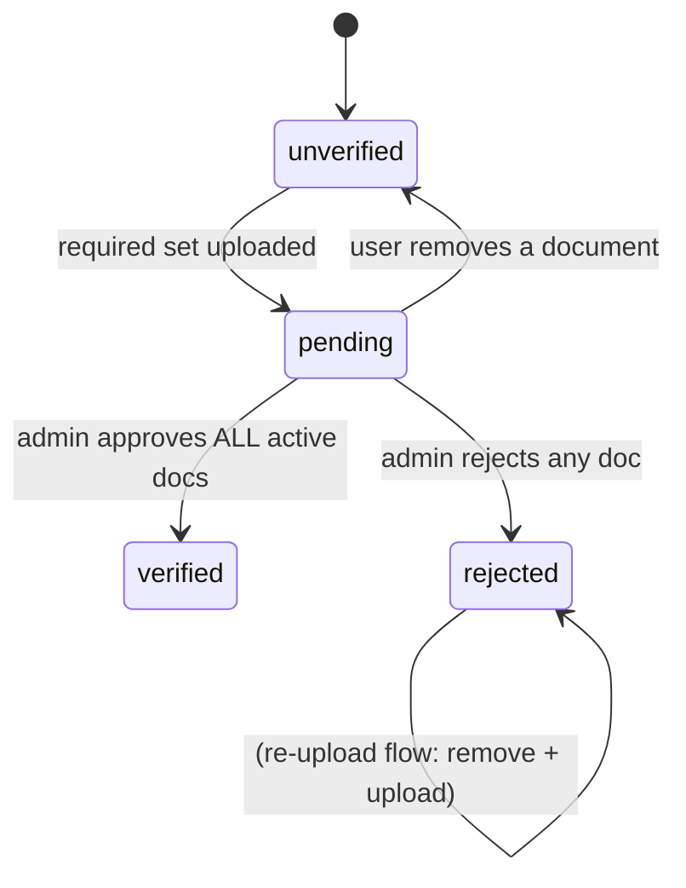

# StocksCo — Project Documentation

> Reference documentation for the StocksCo codebase. Written from a full read of the
> repository (as of commit `3bea0f7`, October 2026). When the code and this document
> disagree, the code wins. Please update this file when you change behaviour.

---

## Table of Contents

1. [What StocksCo Is](#1-what-stocksco-is)
2. [Tech Stack](#2-tech-stack)
3. [Repository Layout](#3-repository-layout)
4. [Architecture Overview](#4-architecture-overview)
5. [Configuration & Environment Variables](#5-configuration--environment-variables)
6. [Running Locally](#6-running-locally)
7. [Deployment](#7-deployment)
8. [Data Model](#8-data-model)
9. [Routes & Endpoints](#9-routes--endpoints)
10. [Core Business Flows](#10-core-business-flows)
11. [Market Data Pipeline](#11-market-data-pipeline)
12. [Service Layer Reference (`app/utils`)](#12-service-layer-reference-apputils)
13. [Frontend](#13-frontend)
14. [Database Migrations](#14-database-migrations)
15. [One-off Scripts](#15-one-off-scripts)
16. [Known Issues & Technical Debt](#16-known-issues--technical-debt)
17. [Glossary](#17-glossary)

---

## 1. What StocksCo Is

StocksCo is a **simulated stock-investing web platform**. Users:

- register and verify their email,
- fund a USD **wallet** with **real cryptocurrency** deposits (via NOWPayments),
- **buy shares** of US stocks at prices cached from Twelve Data (the purchase is
  simulated: no broker is involved; shares are recorded as `Holding` rows and the
  cost is deducted from the wallet),
- put wallet funds into **investment products**: Managed Portfolios (model stock baskets),
  Dollar Savings (flexible, daily interest), Fixed Returns and Treasury Bills (fixed terms),
- track portfolio value, P&L, allocation and history,
- read market news (Marketaux),
- complete **KYC** by uploading ID documents (stored in Cloudflare R2),
- request **withdrawals** to a crypto address (approved manually by an admin),
- earn **referral rewards** (10% of a referred user's first deposit).

An **admin panel** lets staff review KYC, approve/reject withdrawals, inspect users,
transactions and investments, and see platform statistics.

There is a public marketing site as well (landing, about, features, contact, legal pages).

---

## 2. Tech Stack

| Layer | Technology |
|---|---|
| Language | Python 3.11 (CI) / 3.13 (Vercel runtime) |
| Web framework | Flask 3.1 (app factory + Blueprints) |
| ORM | SQLAlchemy 2.0 (typed `Mapped[...]` models) via Flask-SQLAlchemy 3.1 |
| Migrations | Alembic via Flask-Migrate |
| Database | PostgreSQL (`psycopg2-binary`); some admin stats code also supports SQLite |
| Auth | Flask-Login (session cookies), Werkzeug password hashing |
| Rate limiting | Flask-Limiter (in-memory storage) |
| Templates | Jinja2, Bootstrap 5.3 (CDN), Bootstrap Icons, Font Awesome |
| Charts | Chart.js 4.4 (CDN) |
| Market data | Twelve Data (quotes, symbol registry, time series) |
| News | Marketaux |
| Payments | NOWPayments (crypto invoices/payments + IPN webhooks) |
| File storage | Cloudflare R2 (S3-compatible, via `boto3`) |
| Email | Resend |
| Hosting | Vercel (serverless Python) |
| Scheduled jobs | GitHub Actions cron |

---

## 3. Repository Layout

```
Stocks/
├── api/index.py                 # Vercel entry point: app = create_app()
├── run.py                       # Local dev entry point (debug server on :5000)
├── vercel.json                  # Routes every request to api/index.py
├── sync_market_data.py          # CLI: market data sync (--mode fast|full), used by cron
├── run_seed.py                  # One-off: seed `stocks` registry from Twelve Data
├── mark_core_symbols.py         # One-off: flag the 50 core symbols (is_core=True)
├── settle_investments.py        # CLI: pay out matured fixed-term investments (daily cron)
├── requirements.txt
├── .github/workflows/market-sync.yml   # Scheduled market sync (GitHub Actions)
├── migrations/                  # Alembic (Flask-Migrate) migrations
└── app/
    ├── __init__.py              # create_app(): config, extensions, blueprints, filters, error handlers
    ├── database.py              # SQLAlchemy `db`, DeclarativeBase, init_db()
    ├── models/                  # ORM models (one file per domain)
    ├── routes/                  # Blueprints (HTTP layer)
    │   ├── main.py              # Public marketing pages + contact form
    │   ├── auth.py              # Register/login/verify/reset/referral link
    │   ├── dashboard.py         # User dashboard pages + market/buy JSON APIs
    │   ├── payments.py          # Deposits, NOWPayments IPN webhook, invoice page
    │   ├── withdrawals.py       # Withdrawal request API
    │   ├── kyc.py               # KYC document upload/remove/view API
    │   ├── investments.py       # Investment products open/withdraw API
    │   ├── notifications.py     # Notifications page + JSON API
    │   └── admin/admin_dashboard.py  # Admin panel pages + JSON APIs
    ├── utils/                   # Service layer: business logic + external API clients
    ├── templates/               # Jinja templates (landing/, auth/, dashboard/, admin/, errors/)
    └── static/                  # CSS, JS, images
```

---

## 4. Architecture Overview

```mermaid
flowchart LR
    Browser -->|HTML pages + fetch() JSON| Flask[Flask app<br/>Blueprints]
    Flask --> Services[app/utils<br/>service layer]
    Services --> DB[(PostgreSQL)]
    Flask --> DB

    Services -->|create payment / invoice| NP[NOWPayments]
    NP -->|IPN webhook<br/>HMAC-SHA512 signed| Flask
    Services -->|upload / presign| R2[(Cloudflare R2)]
    Services -->|send email| Resend
    Services -->|time series on demand<br/>chart_service| TD[Twelve Data]

    Cron[GitHub Actions cron] --> Sync[sync_market_data.py]
    Sync -->|quotes| TD
    Sync -->|news| MX[Marketaux]
    Sync --> DB
```

### Key design principles (as found in the code)

1. **Routes read market data only from the DB.** Quotes and news are fetched by the
   cron job (`app/utils/twelve_data.py`) and stored in `stock_quotes` / `market_news`.
   The one exception is chart data (`app/utils/chart_service.py`), which calls Twelve
   Data on demand and caches candles in the DB with a TTL per interval.
2. **Service classes own business logic.** `BuyService`, `TransactionService`,
   `WithdrawalService`, `ReferralService`, `kyc_service`, `notifications` hold the
   logic. Routes validate input and shape responses.
3. **Money is `Decimal` / `Numeric`** in the core tables (wallets, transactions,
   holdings, withdrawals). (`crypto_payments` uses `Float`.)
4. **Holdings are append-only.** Each buy creates a new `Holding` row. P&L is computed
   at read time against the latest `StockQuote.close`.
5. **Webhooks are the source of truth for payment status**, with polling
   (`_sync_payment_status`) as a self-healing fallback.

### App factory (`app/__init__.py`)

`create_app()`:

- loads `.env` (`python-dotenv`), sets config from env vars (see §5),
- initialises `db`, `Migrate`, `Limiter` (default `500/day`, `100/hour`, memory storage), `LoginManager` (`login_view = "auth.login"`),
- registers Jinja filters: `compact` (`format_number`, e.g. `1.2M`), `currency` (`$1,234.56`), `stock_domain` (ticker → company domain, used for logos),
- registers blueprints: `auth`, `main`, `dashboard`, `notifications`, `payments`, `wallet`, `kyc`, `admin`,
- runs `init_db()` (currently `db.create_all()`, see §14),
- registers error handlers for 404, 500 (rolls back the session), 429.

**Note:** `app/__init__.py` ends with `app = create_app()` at module level, so **importing
`app` builds an application** (and connects to the DB). Scripts that call `create_app()`
again end up building two apps.

---

## 5. Configuration & Environment Variables

All configuration comes from environment variables (`.env` locally; it is git-ignored).

| Variable | Used by | Purpose |
|---|---|---|
| `SECRET_KEY` | Flask | Session signing. **Required.** |
| `DATABASE_URI` | SQLAlchemy | PostgreSQL connection string. **Required.** |
| `SITE_URL` | emails, referrals | Public base URL used in verification/reset links and referral links (`{SITE_URL}/ref/{code}`) |
| `NOWPAYMENTS_API_KEY` | payments | NOWPayments API key |
| `NOWPAYMENTS_IPN_SECRET` | payments | Secret for verifying IPN webhook signatures |
| `NOWPAYMENTS_SANDBOX` | payments | `true` → use sandbox API |
| `NOWPAYMENTS_IPN_CALLBACK_URL` | payments | Webhook URL; if empty, built from the request host |
| `NOWPAYMENTS_SUCCESS_URL` / `NOWPAYMENTS_CANCEL_URL` | config only | Defaults `/payments/success`, `/payments/cancel` (the deposit route actually builds its own via `url_for`) |
| `NOWPAYMENTS_DEFAULT_CURRENCY` | config | Default `USD` |
| `NOWPAYMENTS_FEE_PAID_BY_USER` | payments | Default `true` |
| `NOWPAYMENTS_FIXED_RATE` | payments | Default `true` |
| `R2_ACCESS_KEY_ID`, `R2_SECRET_ACCESS_KEY`, `R2_BUCKET_NAME`, `R2_ENDPOINT_URL` | KYC storage | Cloudflare R2 credentials |
| `TWELVE_DATA_API_KEY` | market sync, charts | Twelve Data API key (read at **module import** time) |
| `MARKETAUX_API_KEY` | market sync | Marketaux news API key |
| `TWELVE_DATA_CREDITS_PER_RUN` | market sync | Quote credits each `/cron/market-sync` run may spend (1 per symbol). Default `100`. Keep it below your plan's per-minute limit with headroom for charts: `100` on Grow 144/min, `50` on Grow 55/min. The 12 ETF-page funds are fetched first and the 50 core stocks next, so use at least `62` to refresh all of them every run |
| `CRON_SECRET` | `/cron/market-sync` | Shared secret. Callers must send `Authorization: Bearer <CRON_SECRET>` (Vercel Cron does this automatically). Unset → the endpoint always returns 401 |
| `REDIS_URL` (or `KV_URL`) | market cache, rate limiter | Optional. When set, market data and charts are cached in Redis and Flask-Limiter stores counters there. Unset → everything reads from Postgres and the limiter uses memory |
| `RESEND_API_KEY` | email | Resend API key |
| `FROM_EMAIL` | email | Sender address |
| `FINNHUB_API_KEY` | `finhubb_api.py` | Legacy; Finnhub client is instantiated but not used by any route |

Vercel environment variables for market data: `TWELVE_DATA_API_KEY`, `MARKETAUX_API_KEY`,
`CRON_SECRET`, optionally `TWELVE_DATA_CREDITS_PER_RUN` and `REDIS_URL`.

GitHub Actions secrets (settlement + manual syncs): `DATABASE_URI`, `TWELVE_DATA_API_KEY`,
`MARKETAUX_API_KEY`, `SECRET_KEY`, optionally `REDIS_URL`.

---

## 6. Running Locally

```bash
python -m venv .venv
.venv\Scripts\activate          # Windows  (source .venv/bin/activate on macOS/Linux)
pip install -r requirements.txt
# create .env with at least SECRET_KEY and DATABASE_URI (see §5)

flask --app run db upgrade      # apply migrations
python run.py                   # http://localhost:5000 (debug mode)
```

Populate market data (otherwise dashboard/market pages are empty):

```bash
python run_seed.py                       # seed the ~5,500-symbol `stocks` registry
python mark_core_symbols.py              # flag the 50 core symbols
python sync_market_data.py --mode fast   # fetch core quotes + news
```

**Creating an admin:** there is no UI or script for this. Set `users.is_admin = true`
for a user directly in the database. Admins are redirected from `/dashboard*` to
`/admin/dashboard`.

**Testing payments locally:** NOWPayments must be able to reach the IPN webhook
(`/dashboard/payments/webhook/ipn`). Use a tunnel (e.g. ngrok) and set
`NOWPAYMENTS_IPN_CALLBACK_URL`, or use `NOWPAYMENTS_SANDBOX=true`.

To refresh market data locally the same way production does, call the cron endpoint:
`curl -H "Authorization: Bearer $CRON_SECRET" http://localhost:5000/cron/market-sync`.

---

## 7. Deployment

### Web app — Vercel

`vercel.json` builds `api/index.py` with `@vercel/python` (runtime `python3.13`) and
routes **all** paths (`/(.*)`) to it. `api/index.py` simply does `app = create_app()`.
Static files are also served through Flask.

Implications of serverless:
- Flask-Limiter uses Redis when `REDIS_URL` is set (limits shared across instances).
  Without it, it falls back to `memory://`: limits are **per instance** and reset on cold start.
- `create_app()` runs `init_db()` on every cold start: `create_all()` + stamp only when the database is empty, otherwise a check that logs if the schema is behind the migrations (see "Upgrading the production database" below).

### Upgrading the production database

Production holds live user data. Schema changes reach it only through
`flask db upgrade`, run by hand from a local terminal — never automatically on deploy.

**Rules every migration in this repo follows**
- Additive only: new tables, and new columns that are nullable or have a
  server default. Nothing is dropped or renamed in the same release that stops using it.
- The code that is live *before* the deploy keeps working on the upgraded schema.
  That is what makes the order below safe.

**Checklist**

1. Point a terminal at production. The driver must be psycopg2 (what Vercel uses);
   locally on Python 3.14 install it once into the venv with
   `.venv\Scripts\python.exe -m pip install psycopg2-binary==2.9.11`
   (not in `requirements.txt` — 2.9.10 stays pinned for Vercel's Python 3.13).
   ```powershell
   $env:DATABASE_URI = "postgresql://...production..."
   ```
2. `flask db current` — must print a revision id. Blank, or tables with no
   `alembic_version`, means **stop**: the database isn't under migration control
   (see §14, "table already exists").
3. `flask db history -r current:` — lists exactly which migrations will run.
4. **Back up**: `pg_dump` the database, or take a provider snapshot.
5. **Rehearse**: restore that backup into staging and run `flask db upgrade` there.
6. `flask db upgrade` against production. On Postgres the whole upgrade is one
   transaction: if any step fails, nothing is applied.
7. `flask db current` — should now end in `(head)`.
8. **Then** deploy the new code to Vercel. New code needs the new columns; deploying
   it first makes pages that read them fail until the upgrade runs (on startup
   `init_db()` only logs "schema is behind", it doesn't upgrade).
9. Roll back if needed: `flask db downgrade <previous revision>` (every migration has
   a tested downgrade), or restore the backup from step 4.

`init_db()` creates every table from the models only when the database is
**completely empty**, and stamps it at head — that's how a brand-new database is set up.

### Market data — scheduled refresh

| Trigger | Schedule | What runs |
|---|---|---|
| **cron-job.org** (external, free) | every 5 min | `GET /cron/market-sync` with `Authorization: Bearer <CRON_SECRET>` |
| **Vercel Cron** (`vercel.json`, backup) | `30 21 * * 1-5` (once a day after the US close; Hobby allows daily only) | same endpoint |

Each call is one bounded pass (`twelve_data.run_market_sync`, see §11): a few seconds,
no sleeping, so it fits inside a Vercel function. At 5-minute intervals with the default budget, core
stocks refresh every 5 minutes and the whole ~5,500-symbol universe several times a day.

**cron-job.org setup:** create a job with URL `https://<your-domain>/cron/market-sync`,
method GET, schedule every 5 minutes, and a request header
`Authorization: Bearer <CRON_SECRET>`. A healthy run returns 200 with a JSON summary;
502 means no quotes were saved (check `quotes.errors` in the response).

### GitHub Actions (`.github/workflows/market-sync.yml`)

The repo is private (2,000 free Actions minutes/month), so the frequent refresh lives on
Vercel. Actions keeps:

| Job | Trigger | Command | Runtime |
|---|---|---|---|
| `settle-investments` | `15 0 * * *` (00:15 daily) | `python settle_investments.py` | seconds |
| `fast-sync` | manual only | `python sync_market_data.py --mode fast` | ~2 min |
| `full-sync` | manual only | `python sync_market_data.py --mode full` | ~48 min (timeout 90) |
| `seed-etfs` | manual only (~monthly) | `python seed_etfs.py` | ~1 min |

Manual runs: Actions → Market Data Sync → Run workflow → `mode` = `fast` / `full` / `settle` / `seed-etfs`.

---

## 8. Data Model

### Entity-relationship overview



Market tables (`stocks`, `stock_quotes`, `market_news`, `market_data_sync`,
`stock_chart_candles`, `stock_chart_meta`) are not FK-linked to user tables; they join by `symbol`.

### Tables

#### `users` — `app/models/user.py`
| Column | Notes |
|---|---|
| `id`, `email` (unique), `username` (unique), `password_hash` | |
| `first_name`, `last_name`, `phone_number`, `date_of_birth` | |
| `is_admin` | Grants admin panel access |
| `account_status` | `Enum(AccountStatus)`: `ACTIVE`, `SUSPENDED`, `CLOSED`, `PENDING_VERIFICATION` (default) |
| `is_verified` | Email verified |
| `kyc_status` | `unverified` → `pending` → `verified` / `rejected` |
| `kyc_submitted_at`, `kyc_verified_at`, `kyc_rejection_reason` | |
| `id_document_type`, `id_document_number` | Legacy, unused |
| `referral_code` | Unique 8-char code generated at registration |
| `rewards_balance` | Referral earnings (display only; not spendable) |
| `verification_token`, `token_expiry` (24h) | Email verification |
| `reset_token`, `reset_token_expiry` (1h) | Password reset |
| `created_at`, `updated_at`, `last_login` | `last_login` is never written |

#### `wallets` — `app/models/wallet.py`
One per user (`balance Numeric(18,8)`, `currency` = `USD`). Created lazily by
`Wallet.get_or_create(user_id)` (called by dashboard, wallet, stock detail and buy flows).

#### `transactions` — `app/models/transaction.py`
The user-facing **ledger / history table**.
| Column | Values |
|---|---|
| `type` | `Deposit`, `Withdrawal`, `Investment` (wallet → product), `Redemption` (product → wallet). Stock buys do **not** create transactions |
| `description` | `Crypto` for deposits; currency code (e.g. `USDT`) for withdrawals |
| `amount` | `Numeric(18,2)` USD |
| `status` | `pending`, `confirming`, `completed`, `failed`, `expired` |
| `order_id` | `DEPOSIT-XXXXXXXX` (links to `crypto_payments.order_id`), `WITHDRAW-{withdrawal_id}`, or `INV-{position_id}` |
| `date` | |

#### `holdings` — `app/models/holding.py`
One row **per purchase** (`symbol`, `company_name`, `quantity`, `purchase_price`,
`cost_basis = quantity × price`, `purchased_at`). Helper methods: `current_value(price)`,
`profit_loss(price)`, `profit_loss_percent(price)`. There is no sell flow.

#### `crypto_payments`, `payment_callbacks`, `crypto_transactions` — `app/models/payment.py`
- `crypto_payments`: one row per deposit attempt. `payment_type` is `invoice` (hosted
  NOWPayments page) or `payment` (direct address). Holds NOWPayments IDs
  (`payment_id`, `invoice_id`), our `order_id`, amounts, `payment_status`, addresses, URLs.
- `payment_callbacks`: audit log of every verified IPN payload received.
- `crypto_transactions`: on-chain tx tracking (defined, currently unused).
- Helpers: `payment_to_dict`, `is_payment_completed` (`finished`, `confirmed`),
  `is_payment_pending` (`waiting`, `confirming`, `sending`),
  `is_payment_failed` (`failed`, `expired`, `refunded`).

#### `withdrawal_requests` — `app/models/withdrawal.py`
`amount`, `crypto_address`, `crypto_currency`, `status` (`pending` → `approved` / `rejected`),
`user_note`, `admin_note`, `actioned_by` (admin user id), `actioned_at`, `transaction_id` → `transactions.id`.

#### `kyc_documents` — `app/models/kyc_document.py`
`document_type` (one of `passport`, `national_id_front`, `national_id_back`,
`drivers_license_front`, `drivers_license_back`, `voters_card`, `proof_of_address`),
`file_name`, `storage_key` (R2 key `users/{id}/kyc/{type}_{uuid}.{ext}`), `file_size`,
`mime_type`, `status` (`pending`/`approved`/`rejected`), `rejection_reason`,
`reviewed_at`, `reviewed_by`, `is_deleted` (soft delete).

#### `referrals` — `app/models/referral.py`
`referrer_id`, `referred_id` (unique: a user can only be referred once), `status`
(`pending` → `completed`), `reward_amount`, `created_at`, `completed_at`.

#### `investment_products`, `investment_positions`, `investment_lots` — `app/models/investment.py`
- `investment_products`: admin-configurable settings per product (`code`, `product_type`
  = `savings` / `fixed_term` / `managed`, `min_amount`, `is_active`, and `terms` JSON:
  `[{"days": int|null, "rate": float}]`, where rate is a simple annual % rate). Default rows are
  inserted on first access by `investment_service.get_products()`.
- `investment_positions`: one row per user investment. `principal`, `rate` and `term_days`
  are locked at open, plus `accrual_start`, `matures_at` and `status` (`active` → `matured` / `closed`).
  `realized_gain` holds interest credited (or managed P&L at sale) and `payout_amount` the amount returned to the wallet.
  **Accrued interest is not stored**; it is computed on read.
- `investment_lots`: fractional shares (`shares Numeric(20,8)`) bought for a managed position.

#### `notifications`, `notification_preferences` — `app/models/notification.py`
- `notifications`: `type` (`success`/`warning`/`info`/`danger`), `category`
  (`trade`, `wallet`, `security`, `kyc`, `system`, `promotion`, `account`), `priority`,
  `title`, `message`, `action_text/url`, `is_read`, `notification_metadata` (JSON),
  `related_object_type/id`, `expires_at`, `deleted_at` (soft delete), email/push flags.
  `to_dict()` adds a human relative time (`"5 min ago"`).
- `notification_preferences`: per-category on/off switches plus delivery and digest
  flags. Only the category switches are enforced (`should_send_notification`).

#### `contact_us_messages` — `app/models/contact_us.py`
Submissions from the public contact form (`status` enum: unread/read/in_progress/resolved/closed).

#### Market data — `app/models/market_data.py`, `app/models/stock_chart.py`
| Table | Purpose |
|---|---|
| `stocks` | **Symbol registry** (~5,500 NASDAQ/NYSE common stocks). `is_active`, `is_core` (the ~50 symbols refreshed every 30 min). Used by search and the sync job. |
| `stock_quotes` | **Latest quote per symbol** (open/high/low/close/previous_close/change/percent_change/volume, `is_big_tech`, `is_market_open`, `fetched_at`). Overwritten by each sync. |
| `market_news` | Latest Marketaux articles (deduplicated by URL, pruned to 20). `tickers` CSV, `sentiment`. |
| `market_data_sync` | Health/control rows for the sync pipeline (`last_successful_fetch`, `consecutive_failures`, `last_error`, ...). |
| `stock_chart_candles` | Cached OHLCV candles per `(symbol, interval, datetime)`. |
| `stock_chart_meta` | Last fetch time per `(symbol, interval)` for TTL checks. |

`app/models/stock.py` is an empty file.

---

## 9. Routes & Endpoints

Legend: 🔒 = `@login_required`, 🛡 = `@admin_only` (403 for non-admins), ⏱ = rate limited.

### Public — `main` blueprint (`app/routes/main.py`)
| Method | Path | Description |
|---|---|---|
| GET | `/` | Landing page |
| GET | `/about-us`, `/features` | Marketing pages |
| GET/POST | `/contact-us` | Contact form → `contact_us_messages` |
| GET | `/terms&conditions`, `/privacy`, `/cookie`, `/legal` | Legal pages |

### Auth — `auth` blueprint (`app/routes/auth.py`)
| Method | Path | Description |
|---|---|---|
| GET/POST | `/login` ⏱5/min | Email + password login. Admins → `/admin/dashboard`; honours `?next=` |
| GET/POST | `/register` ⏱5/day | Create user, generate referral code, record referral from session, send verification email |
| GET | `/email-sent` | "Check your inbox" page (needs `pending_email` in session) |
| POST | `/resend-verification` ⏱3/10min | Re-issue verification token + email (JSON response) |
| GET | `/verify?token=` | Verify email → `is_verified=True`, `account_status=ACTIVE` |
| GET/POST | `/forget-password` ⏱3/hour | Send reset link (always shows the same message) |
| GET/POST | `/reset-password?token=` | Set new password (token valid 1h) |
| POST | `/change-password` 🔒 | Change password from Settings |
| GET | `/logout` 🔒 | Log out |
| GET | `/ref/<code>` | Store referral code in session → redirect to `/register` |

### User dashboard — `dashboard` blueprint (`app/routes/dashboard.py`)
A `before_request` hook redirects admins to `/admin/dashboard`.

| Method | Path | Description |
|---|---|---|
| GET | `/dashboard` 🔒 | Home: net worth, portfolio chart, my assets, big tech, popular stocks, gainers/losers, news, recent activity |
| GET | `/dashboard/invest` 🔒 | Stock cards + investment product cards, **My Investments** section. Settles the user's matured fixed-term positions on load |
| GET | `/dashboard/markets` 🔒 | Markets overview (featured stock, gainers/losers, news) |
| GET | `/dashboard/markets/<symbol>` 🔒 | Stock detail page with buy box, related stocks, related news |
| GET | `/dashboard/markets/<symbol>/chart?interval=` 🔒⏱ | JSON candles (`1min`,`5min`,`15min`,`1h`,`1day`,`1week`) via `chart_service` |
| GET | `/dashboard/portfolio` 🔒 | Holdings table, P&L, value history line chart, asset-type donut chart |
| GET | `/dashboard/wallet` 🔒 | Wallet balance + transaction history; deposit/withdraw modals |
| GET/POST | `/dashboard/settings` 🔒 | Profile (POST saves first/last name, phone), password, KYC tabs (`?tab=`) |
| GET | `/dashboard/insights` 🔒 | Paginated news (10/page) |
| GET | `/dashboard/referrals` 🔒 | Referral code/link, invites table, rewards |
| GET | `/dashboard/support` 🔒 | Support page |
| GET | `/dashboard/stock-etfs`, `/dashboard/crypto-etfs` 🔒 | ETF pages: funds from `etf_catalog.py` with live prices from the snapshot. Missing or stale prices are fetched in one request on load (`ensure_fresh_quotes`). The search box filters the featured cards and searches every ETF (`/api/etfs/search`). Quick Invest buys whole shares through `POST /api/buy` |
| GET | `/api/market/quotes` 🔒 (300/hour) | JSON from the cached snapshot: core quotes + top movers + `last_updated`. Polled every 60 s by `market-live.js` |
| POST | `/api/buy` 🔒 | JSON `{symbol, quantity}` → `BuyService.buy` (200 success / 400 error / 402 insufficient funds). A stale stored price is refreshed from Twelve Data first. Leveraged/inverse ETFs are refused |
| GET | `/api/etfs/search?q=&kind=stock\|crypto&limit=` 🔒 (600/hour) | Search every active, non-leveraged ETF in the registry. `crypto` = `CRYPTO_ETF_UNIVERSE` only, `stock` = all others. Ranked: exact ticker, ticker prefix, featured funds, most traded. Returns stored prices with `fetched_at`; no API calls |
| GET | `/api/etfs/quote/<symbol>` 🔒 (120/hour) | One ETF's price, refreshed (1 credit) if stale. Used when a search result's Buy is pressed. 404 for unknown or leveraged funds |
| GET | `/api/stocks?tab=all\|gainers\|losers&q=&limit=` 🔒 | Quotes for the stock-selection modal (max 50) |
| GET | `/api/stocks/search?q=&limit=` | Registry search (`stocks`) enriched with quotes (max 20). Not login-protected |

### Investments — `investments` blueprint, prefix `/api/investments` (`app/routes/investments.py`)
| Method | Path | Description |
|---|---|---|
| POST | `/api/investments/open` 🔒⏱20/min | JSON `{product_code, amount, term_days?, portfolio_code?}`. Opening Dollar Savings when a savings position exists tops it up. 402 on insufficient funds |
| POST | `/api/investments/<id>/withdraw` 🔒⏱20/min | JSON `{amount?}`. Savings: partial or full withdrawal. Fixed term: payout at maturity, or principal only before maturity. Managed: sell all at latest prices |

### Notifications — `notifications` blueprint (`app/routes/notifications.py`)
| Method | Path | Description |
|---|---|---|
| GET | `/dashboard/notifications` 🔒 | Notifications page |
| GET | `/api/notifications?unread_only=&category=&limit=` 🔒 | List |
| GET | `/api/notifications/unread-count` 🔒 | Badge count |
| POST | `/api/notifications/<id>/read` 🔒 | Mark one read |
| POST | `/api/notifications/mark-all-read` 🔒 | Mark all read |
| DELETE | `/api/notifications/<id>` 🔒 | Soft delete |
| GET/PUT | `/api/notifications/preferences` 🔒 | Read/update preferences |

### Cron — `cron` blueprint, prefix `/cron` (`app/routes/cron.py`)
| Method | Path | Description |
|---|---|---|
| GET/POST | `/cron/market-sync` | Requires `Authorization: Bearer <CRON_SECRET>` (401 otherwise). Exempt from rate limits. Runs `run_market_sync()`; 200 + JSON summary, or 502 if no quotes were saved |

### Payments — `payments` blueprint, prefix `/dashboard/payments` (`app/routes/payments.py`)
| Method | Path | Description |
|---|---|---|
| POST | `/deposit` 🔒 | JSON `{amount, currency?, payment_method:"crypto", pay_currency?}`. Min $20. Creates NOWPayments invoice (no `pay_currency`) or direct payment, saves `CryptoPayment` + pending `Transaction`, notifies user |
| GET | `/invoice/<invoice_id>` 🔒 | Invoice status page (polls status if pending) |
| GET | `/status/<order_id>` 🔒 | JSON status; polls NOWPayments when pending (used by invoice page JS) |
| POST | `/webhook/ipn` | **NOWPayments IPN webhook** (public, signature-verified) |
| GET | `/success`, `/cancel` | Return URLs from NOWPayments (templates missing, see §16) |
| GET | `/list` 🔒 | User payment list (template missing) |
| GET | `/admin/payments` 🔒 | All payments (no admin check; template missing) |
| GET | `/api/currencies` 🔒 | Available cryptocurrencies |
| POST | `/api/estimate` 🔒 | Exchange-rate estimate `{amount, currency_from, currency_to}` |

### Withdrawals — `wallet` blueprint, prefix `/wallet` (`app/routes/withdrawals.py`)
| Method | Path | Description |
|---|---|---|
| POST | `/wallet/withdraw` 🔒 | JSON `{amount, crypto_address, crypto_currency, user_note?}` → `WithdrawalService.submit` |

### KYC — `kyc` blueprint, prefix `/kyc` (`app/routes/kyc.py`)
| Method | Path | Description |
|---|---|---|
| POST | `/kyc/upload` 🔒 | multipart `document_type` + `file` → R2 + `kyc_documents` |
| DELETE | `/kyc/document/<id>/remove` 🔒 | Soft-delete own document (not allowed once verified) |
| GET | `/kyc/status` 🔒 | KYC status + documents |
| GET | `/kyc/document/<id>/view` 🔒 | 1-hour presigned R2 URL for own document |

### Admin — `admin` blueprint (`app/routes/admin/`)
All routes are 🔒🛡. The blueprint is defined in `admin_dashboard.py`; `user_detail.py`,
`inbox.py` and `exports.py` add their routes to it (imported at the bottom of `admin_dashboard.py`).

Every state-changing admin action writes an `admin_audit_logs` row **in the same commit**
as the change (`app/utils/audit.py` → `log_admin_action`), so an action can't happen without its record.

| Method | Path | Description |
|---|---|---|
| GET | `/admin/dashboard` | Users, managed assets (cash + stocks + investments), wallet cash, today's trading volume; "needs attention" cards (pending withdrawals, KYC, stuck deposits, flagged, payouts due in 7 days) linking to filtered lists; deposits vs withdrawals chart (today/7d/30d/90d); activity feed |
| GET | `/admin/user-management` | Users list (links to the user page), CSV export, broadcast |
| GET | `/admin/api/users` | Paginated/filterable users JSON |
| GET | `/admin/users/<id>` | User page: money, transactions, withdrawals (with payout hashes), holdings, investment positions, KYC docs, referrals, internal notes, admin actions on the account |
| GET | `/admin/api/users/<id>/profile` | Profile JSON for the drawer |
| POST | `/admin/api/users/<id>/toggle-suspend` | Suspend / unsuspend (refused for closed accounts) |
| POST | `/admin/api/users/<id>/close` · `/reopen` | Close (only with no balance, pending withdrawal, holdings or active investments) / reopen; reason required |
| POST | `/admin/api/users/<id>/send-password-reset` | Email the standard reset link |
| POST | `/admin/api/users/<id>/adjust-wallet` | Credit/debit with a reason shown to the user; atomic, can't overdraw; recorded as Credit/Debit Adjustment |
| POST | `/admin/api/users/<id>/notes` | Add an internal note (append-only) |
| POST | `/admin/api/users/<id>/message` | In-app message to one user (ignores muted categories) |
| POST | `/admin/api/broadcast` | Message an audience (all / KYC-verified / not verified); `dry_run` returns the count; respects opt-outs |
| GET | `/admin/kyc-compliance` | KYC queue (tabs by status, search, doc type, date filters; 13/page) |
| GET | `/admin/kyc/<doc_id>/` · `/detail-json` | KYC document detail page / JSON for the drawer (presigned URLs) |
| POST | `/admin/kyc/<doc_id>/approve` · `/reject` | Pending documents only (409 otherwise); the user's KYC status is recomputed from all their documents; they're notified only when it changes |
| GET | `/admin/transactions` | Transactions page (reads `?type=&status=&date=` from the URL) |
| GET | `/admin/api/transactions` | Paginated/filterable JSON, incl. `status=stuck` and `status=flagged`; pending withdrawals carry risk checks |
| POST | `/admin/transactions/<tx_id>/approve` | Approve a pending withdrawal — requires `payout_tx_hash` |
| POST | `/admin/transactions/<tx_id>/reject` | Reject + refund — requires a reason (sent to the user) |
| POST | `/admin/transactions/<tx_id>/credit-deposit` | Manually credit a deposit whose webhook was lost |
| POST | `/admin/transactions/<tx_id>/flag` · `/unflag` | Flag with a reason / clear with a review note (admin-only, never shown to the user) |
| GET | `/admin/investments` | Stock holdings tab + investment positions tab |
| GET | `/admin/api/investments` · `/admin/api/investment-positions` | Holdings with value and gain / positions with status, product and `due=1` (maturing in 7 days) filters |
| GET | `/admin/inbox` · `/admin/api/inbox` | Contact-us messages (open/all/status filters) |
| POST | `/admin/api/inbox/<id>/status` | Set a message's status |
| GET | `/admin/export/users.csv` · `transactions.csv` · `kyc.csv` | CSV of the list with the same filters (formula-safe, max 50,000 rows, audit-logged) |
| GET | `/admin/audit-log` · `/admin/api/audit-log` | Read-only log of admin actions (filters: action, admin, target id, date) |
| GET/POST | `/admin/settings` | Admin's own profile; Investment Products tab |
| GET | `/admin/api/investment-products` | Product settings JSON |
| PUT | `/admin/api/investment-products/<code>` | Update `min_amount`, `is_active`, `terms` (rates capped at 20% a year) |

---

## 10. Core Business Flows

### 10.1 Registration, verification & referrals



- Login does **not** require `is_verified` (unverified users can log in).
- Referral reward is paid when the referred user's **first deposit completes**
  (see 10.2): `reward = 10% × deposit`, added to the referrer's `rewards_balance`,
  `Referral.status = completed`. Self-referral and double-referral are blocked.

### 10.2 Deposit (crypto via NOWPayments)



- IPN matching: first by `payment_id`, then by `invoice_id` (first IPN for an invoice
  saves the `payment_id` for later lookups). Unknown payments get a 200 so NOWPayments stops retrying.
- Fallback: `/status/<order_id>` and the invoice page call `_sync_payment_status`, which
  polls `GET /payment/{payment_id}` and runs the same handlers. Invoices with no
  `payment_id` yet cannot be polled (that endpoint needs JWT auth) and wait for the IPN.
- Status mapping (`TransactionService.update_status`): `waiting→pending`,
  `confirming→confirming`, `confirmed/finished→completed`, `failed→failed`,
  `expired→expired`, `partially_paid→pending`. The wallet is credited **once**, on the
  first transition to `completed`.
- A deposit needs the user's wallet to exist; otherwise the `Transaction` is not created
  (and the wallet is never credited). Wallets are created on first dashboard/wallet visit.

### 10.3 Buying a stock (simulated)

`POST /api/buy {symbol, quantity}` → `BuyService.buy`:

1. Validate: symbol non-empty, `1 ≤ quantity ≤ 10,000` (integer shares only).
2. Price = `stock_quotes.close` (cached; must exist and be non-null).
3. `total = price × quantity`. If `wallet.balance < total` → 402 with a "need $X more" message.
4. In one DB commit: debit the wallet with `UPDATE ... SET balance = balance - total
   WHERE balance >= total` (so two buys at once can't spend the same money), insert the
   `Holding`, and insert a `Transaction(type="Buy", status="completed")` for the history.
5. Route sends a `trade` notification.

There is no sell endpoint. Buys made before this change have no `Transaction` row.

### 10.4 Portfolio calculations (`/dashboard/portfolio`, `/dashboard`)

- **Current value** per holding = `latest close × quantity`; **P&L** = value − cost basis.
- **Day change** = Σ `(close − previous_close) × quantity`; % relative to current value.
- **History chart**: one point per purchase date with the cumulative **cost basis**,
  plus a final "today" point at **market value** (so it is an invested-capital curve
  with a live endpoint, not a true historical valuation).
- **Breakdown donut**: grouped into `ETFs` (hard-coded symbol set), `Big Tech`
  (`is_big_tech`), or `Stocks`.
- **Dashboard net worth** = wallet balance + holdings market value.

### 10.4b Investment products (`app/utils/investment_service.py`)

| Product | Code | Type | Defaults (editable by admin) |
|---|---|---|---|
| Managed Portfolio | `managed_portfolio` | `managed` | min $500; baskets `conservative` / `balanced` / `growth` in `app/utils/managed_portfolios.py` (core symbols only) |
| Dollar Savings | `dollar_savings` | `savings` | min $1,000; 3.5% p.a.; top-ups ≥ $1 |
| Fixed Returns | `fixed_returns` | `fixed_term` | min $50,000; 90d 5.0%, 180d 5.5%, 365d 6.5% |
| Treasury Bills | `treasury_bills` | `fixed_term` | min $1,000,000; 91d 4.0%, 182d 4.0%, 364d 3.9% (product modelled on T-bill tenors; the platform does not buy real T-bills) |

- **Interest:** simple, accrues per second: `principal × rate% × seconds / (365 days)`, rounded down to the cent, capped at `matures_at`.
- **Savings:** a top-up or partial withdrawal first **capitalises** accrued interest into
  `principal` and resets `accrual_start`. A top-up also moves the balance to the product's
  current rate (variable rate). Withdrawing everything closes the position.
- **Fixed term:** rate and term are locked at open. At maturity, principal + full-term interest
  goes to the wallet (`status = matured`). An early exit returns the **principal only**; the accrued interest is forfeited (`status = closed`).
- **Managed:** the amount is split by basket weight into fractional-share lots at the latest
  `stock_quotes.close`. The last lot takes the rounding remainder, so costs sum exactly to the amount.
  Value = Σ shares × latest close. Selling liquidates all lots at the latest prices, and is refused if any quote is missing.
- **Settlement:** `settle_matured()` runs daily via `settle_investments.py` (GitHub Actions)
  **and** for the current user whenever `/dashboard/invest` loads, so payouts never wait on the cron.
- **Concurrency:** wallet and position rows are locked with `SELECT … FOR UPDATE`. A
  position that is already closed can't be paid out twice.
- **Ledger:** each wallet movement writes a completed `Transaction` (`Investment` / `Redemption`, `order_id = INV-{id}`) and sends a notification.
- **Net worth:** the dashboard net worth includes active investment value (`investment_service.total_value`).

### 10.5 Withdrawal



- Rules: currency ∈ `BTC, ETH, USDT, USDC, BNB, SOL, TRX`; minimum $10; sufficient balance.
- Admin acts on the **transaction id**; the withdrawal is found through
  `withdrawal_requests.transaction_id` (older rows: `order_id = WITHDRAW-{id}`).
- Approve/reject claim the request with `UPDATE ... WHERE status = 'pending'`, so two
  admins (or a double-click) can't both act on it; the reject refund is applied in SQL.
- **Payout is manual.** The admin sends the crypto outside the system, then approves
  with the on-chain tx hash (stored, shown to the user). The modal shows risk checks:
  KYC, account age, new or shared address, deposits in the last 24h, lifetime in/out.
  (`NOWPaymentsService.create_payout` exists but is not wired up.)
- KYC status is **not** checked before withdrawals or deposits.

### 10.6 KYC



- **Required set:** `proof_of_address` **plus** one valid ID: `passport`, or
  `national_id_front` + `national_id_back`, or `drivers_license_front` + `drivers_license_back`, or `voters_card`.
- Upload rules: JPG/PNG/WEBP/PDF, ≤ 10 MB, one active document per type. Files go to R2
  under `users/{user_id}/kyc/`; never exposed directly, only through 1-hour presigned URLs.
- Removal is a soft delete in the DB plus a best-effort R2 delete; blocked once verified.

### 10.7 Notifications

`app/utils/notifications.py` provides `create_notification(...)` (respects the user's
category preferences) and helpers: `notify_trade_completed`, `notify_wallet_funded`,
`notify_transaction_pending`, `notify_transaction_failed`, `notify_withdrawal_pending`,
`notify_withdrawal_completed`, `notify_withdrawal_failed`, `notify_security_alert`,
`notify_kyc_status`. Plus read/delete/preference helpers and cleanup functions
(`cleanup_expired_notifications`, `cleanup_old_read_notifications`), which nothing
schedules yet. Email/push delivery is a TODO; notifications are in-app only.

The dashboard "Recent activity" feed (`recent_activity_helper.get_recent_activity`)
merges the user's transactions with `trade`/`wallet` notifications, sorted by date.

---

## 11. Market Data Pipeline

Fetching is in `app/utils/twelve_data.py`. Reads for the Markets tab go through
`app/utils/market_snapshot.py`, with an optional Redis cache (`app/utils/market_cache.py`).

```
cron-job.org / Vercel Cron ──► /cron/market-sync ──► run_market_sync()
                                                        │  Twelve Data /quote, Marketaux
                                                        ▼
                                          Postgres (stock_quotes, market_news)  ◄── source of truth
                                                        │  refresh_snapshot()       (buy/invest pricing
                                                        ▼                            reads it directly)
                                          Redis: market:snapshot, market:news, chart:*
                                                        │
                       /dashboard/markets, /api/market/quotes (polled every 60 s by market-live.js)
```

### Symbol sets
- `app/utils/market_symbols.py`: `BIG_TECH_SYMBOLS` (7: AAPL, MSFT, GOOGL, META, AMZN,
  NVDA, TSLA) + `MARKET_SYMBOLS` (43 across sectors) = `ALL_SYMBOLS` (50). This is the
  fallback list and the source for `is_core` and `is_big_tech`.
- `stocks` table: full registry seeded by `fetch_and_seed_symbols()` (NASDAQ + NYSE common
  stocks; symbols with `. + * ^ ~` skipped). `is_core` is preserved across re-seeds.

### Incremental sync — `run_market_sync()` (the scheduled path)
Called by `/cron/market-sync`. One bounded pass, no sleeping:
1. **Pick symbols** within `TWELVE_DATA_CREDITS_PER_RUN` (default 100): the 12 ETF-page funds
   (`etf_catalog.ALL_ETF_SYMBOLS`) first, then every core symbol
   (`stocks.is_core`, falling back to `ALL_SYMBOLS`), then the stalest other active symbols (stocks and ETFs; leveraged ETFs are skipped)
   (never-quoted first, then oldest `fetched_at`). The universe rotates over successive runs.
2. **Fetch** with `/quote` in requests of up to 120 symbols. A 429 or failure is recorded
   and the next run carries on. There are no retries or sleeps.
3. **Save** each request's quotes with one SELECT and one commit. Values that would overflow
   a column (`percent_change` ≥ 10,000, prices ≥ 10⁸, volume > 2³¹) are stored as NULL,
   so one odd symbol can't make Postgres reject the batch.
4. **News** (Marketaux) only if the last attempt was ≥ 30 min ago, to protect the daily quota.
5. **Health:** `market_data_sync` row `quotes` (plus `news`).
6. **`refresh_snapshot()`** rewrites the Redis snapshot and news.

`fetch_quote_now(symbol)` is the on-demand variant (1 credit): `/dashboard/markets/<symbol>`
calls it when the stored quote is missing, older than 15 min while the market was open, or
older than 24 h otherwise. It only does this for symbols in the active `stocks` registry, so typed-in URLs never spend credits.

### Script sync modes (`sync_market_data.py`, manual)
| Mode | Symbols | News | Notes |
|---|---|---|---|
| `fast` | `stocks.is_active AND is_core` (~50) | Yes | ~2 min |
| `full` | all `stocks.is_active` (~5,520) | No | Batches of 120 symbols, 62 s pause between batches (Grow 144 credits/min); on 429, waits 65 s and retries up to twice. ~48 min, so it can't run on Vercel |

Both fall back to `ALL_SYMBOLS` if the registry is empty, write `market_data_sync` rows
`quotes_fast` / `quotes_full`, and call `refresh_snapshot()` at the end. The script
exits 1 if `overall_success` is false.

- **News:** Marketaux `/news/all` filtered to `ALL_SYMBOLS`, 20 articles; deduplicated
  by URL; sentiment derived from the first entity's `sentiment_score` (>0.1 positive,
  <−0.1 negative); table pruned to the newest 20.

### ETF universe (`fetch_and_seed_etfs`, `etf_catalog.py`)
- One call to Twelve Data `/etfs?country=United States` (~11,400 rows). Its list includes mutual
  funds, so rows are classified by ISO 10962 CFI code: `CE` = ETF (kept); `ES` kept only with a
  fund-like name (catches trusts such as ETHA/ETHE); `CI` (mutual funds) and OTC listings skipped.
  Result: ~5,000 ETFs plus ~800 leveraged/inverse.
- **Leveraged/inverse** funds are detected by name (they must say so: "2X", "Bear", "UltraShort",
  "Short S&P 500"…), with exceptions for short-maturity bond funds ("Ultra-Short Income",
  "Short-Term Treasury") and long/short funds. Stored as asset type `Leveraged ETF`: hidden from
  all searches, skipped by the rotation, refused by `BuyService`.
- Existing stock rows are never overwritten (two old company tickers, GRIN and ISRL, collide).
  ETFs missing from a full list are marked inactive.
- **Crypto vs stock ETFs:** the Crypto page searches only `CRYPTO_ETF_UNIVERSE`, a hand-checked
  list (~150 funds, reviewed 2026-10-07). The Stock page searches every other ETF. New crypto funds
  appear on the Stock page until added to that list.
- Freshness: with the default budget, each of the ~11,000 stocks + ETFs is re-priced roughly once
  a day by the rotation. Search results show "as of" times, and buying always refreshes a stale price.

### Markets tab read model (`market_snapshot.py`)
- **Movers exclude all ETFs**, so leveraged funds can't crowd out stocks.
- **Snapshot** = `core` (core-symbol quotes, by `percent_change` desc; `core[0]` is the
  featured stock), `gainers` / `losers` (top 10 across the whole universe, limited to quotes
  within 24 h of the newest fetch with volume ≥ 500k and price ≥ $1, so penny stocks stay out),
  and `updated_at` (latest success across `quotes`, `quotes_fast`, `quotes_full`).
- `get_snapshot()` / `get_news()` read Redis first. On a miss they build from Postgres and
  write back (TTL 15 min / 30 min as a safety net; each sync rewrites them).
- `to_view()` turns cached dicts back into attribute objects, so templates keep using
  `stock.close` and `s.fetched_at.strftime(...)`.

### Redis cache (`market_cache.py`)
- Enabled only when `REDIS_URL` / `KV_URL` is set. Keys are prefixed `stocksco:`.
- Fails soft: 1 s socket timeouts. On any error (server down, package missing, bad URL)
  callers get `None` and use Postgres, and the cache is skipped for 60 s so a dead Redis
  doesn't slow every request.
- On Vercel: Storage → Create Database → Upstash for Redis. Then copy the TLS
  (`rediss://…`) connection string into `REDIS_URL` if the integration didn't add it.

### Charts (on-demand)
`app/utils/chart_service.get_chart_data(symbol, interval)`:
- If `stock_chart_meta` says the cache is fresh (TTL: 1min→2 min, 5min→5 min,
  15min→15 min, 1h→1 h, 1day→12 h, 1week→3 days), serve from `stock_chart_candles`.
- Else call Twelve Data `/time_series` (output sizes 100/100/100/90/365/104), replace
  the candles for that symbol+interval, update meta.
- Returns `{symbol, interval, candles:[{t,o,h,l,c,v}]}` oldest → newest for Chart.js.
- With Redis enabled, the result is cached at `chart:<SYMBOL>:<interval>` for the same TTL,
  but only when the data is known to be fresh. After a failed API call, the next request retries.

---

## 12. Service Layer Reference (`app/utils`)

| Module | Responsibility |
|---|---|
| `admin_decorator.py` | `@admin_only` → 403 unless `current_user.is_admin` |
| `admin_stats_service.py` | Admin dashboard data: counts, cumulative completed-transaction volume series (Postgres `date_trunc` / SQLite fallback), activity feed |
| `auth_helpers.py` | `get_user_by_email`, `verify_user`, `verify_reset_password` (clears reset token) |
| `auth_tokens.py` | `secrets.token_urlsafe(32)` tokens; verification (24h) and reset (1h) create/validate |
| `buy_service.py` | `BuyService.buy` (§10.3) |
| `chart_service.py` | Cached time series (§11) |
| `email.py` | Resend emails with inline HTML: verification, password reset, payment confirmation |
| `finhubb_api.py` | Legacy Finnhub client. Only `format_number` (the `compact` filter) is used |
| `investment_service.py` | Investment products: defaults/config, open/top-up, withdraw/exit/sell, valuation, maturity settlement (§10.4b) |
| `kyc_service.py` | KYC rules, upload, removal (§10.6) |
| `managed_portfolios.py` | Managed portfolio basket definitions (symbol weights) |
| `etf_catalog.py` | Funds on the Stocks ETFs / Crypto ETFs pages (symbol, display name, risk label, one-line summary; crypto funds also a `kind`: Spot / Futures / Company stocks). Add or remove a fund here; the sync, pages and guide pick it up. Keep summaries to stable facts (no fees or holding counts). Also holds `CRYPTO_ETF_UNIVERSE` (hand-checked crypto funds for the Crypto page search; add new launches here) and `classify_etf_row()` / `is_leveraged_name()` used by the ETF seed |
| `market_cache.py` | Optional fail-soft Redis JSON cache (§11) |
| `market_snapshot.py` | Markets tab read model: core quotes, movers, news, last updated; Redis → Postgres (§11) |
| `market_symbols.py` | Core symbol lists (§11) |
| `notifications.py` | Notification creation, queries, preferences, cleanup (§10.7) |
| `nowpayments.py` | `NOWPaymentsService` API client (currencies, estimate, min amount, create payment/invoice, status, payouts, IPN signature verification) + `PaymentStatus`/`InvoiceStatus` constants |
| `recent_activity_helper.py` | User dashboard activity feed |
| `referral_service.py` | Code generation, signup attribution, reward on first completed deposit (§10.1) |
| `storage_service.py` | R2 client, `upload_document`, `delete_document`, `generate_presigned_url` |
| `transactions.py` | `TransactionService`: `create_deposit`, `update_status` (credits wallet + referral hook), queries |
| `twelve_data.py` | Market data pipeline: registry seed, incremental + script syncs, on-demand quote, news, sync health (§11) |
| `withdrawal_service.py` | `WithdrawalService.submit / approve / reject` + queries (§10.5) |

---

## 13. Frontend

Server-rendered Jinja templates with vanilla JavaScript; Bootstrap 5.3 and Chart.js from CDN.

### Template structure
- `templates/landing/layouts/base.html`: public site layout. Pages: `index`, `about-us`, `features`, `contact-us`, `terms`, `privacy`, `cookie`, `legal`.
- `templates/auth/layouts/auth-base.html`: auth layout. Pages: `login`, `register`, `email-sent`, `forget-password`, `reset-password`.
- `templates/dashboard/partials/_base.html`: user app shell (`layouts/_sidebar.html`, `layouts/_topbar.html`).
  - Pages: `dashboard`, `invest`, `markets`, `stock-detail`, `portfolio`, `wallet`, `insights`, `notifications`, `referrals`, `settings`, `support`, `stock-etfs`, `crypto-etfs`, `payments/invoice`.
  - `partials/components/_*.html`: reusable widgets (stock ticker, watchlist, holdings table, portfolio overview/analytics, price chart, wallet balance, KYC settings, ...).
  - `partials/modals/`: deposit, withdraw, stock-selection modals.
- `templates/admin/base.html`: admin shell. Pages: `dashboard`, `user-management`, `kyc-compliance`, `kyc-detail`, `transaction`, `investment`, `settings`. Most admin pages are client-rendered from the `/admin/api/*` JSON endpoints by inline `<script>`.
- `templates/errors/`: `404.html`, `500.html`.

CSS mirrors this structure under `static/css/{landing,dashboard,admin,errors}`.

### JavaScript (`app/static/js`) → endpoints
| File | Calls |
|---|---|
| `deposit-modal.js` | `POST /dashboard/payments/deposit` → redirects to invoice URL |
| `withdrawal-modal.js` | `POST /wallet/withdraw` |
| `price-chart.js` | `GET /dashboard/markets/<symbol>/chart?interval=` |
| `stock-selection-modal.js` | `GET /api/stocks`, chart endpoint for sparklines |
| `market-search.js` | `GET /api/stocks/search` |
| `market-live.js` | Polls `GET /api/market/quotes` every 60 s (paused while the tab is hidden) and updates elements marked `data-live-symbol` / `data-live="price\|change-pct\|change-arrow\|change-full\|pct-text\|open\|high\|low\|previous_close"` and `data-live-updated` on the Markets and ETF pages. Fires a `market-live:update` event with the new quotes |
| `etf-page.js` | ETF pages: sparklines from the chart endpoint (last 30 daily closes), search (featured cards + all-ETF results with price, "as of" time, Buy and Details), "Buy ETF" pre-select, Quick Invest whole-share calculation and `POST /api/buy`, and the "Learn More" guide panel (`_etf-guide.html`: moved under `<body>` because `.main-content` is scaled; Esc / outside click / ✕ close; focus kept inside; each fund's Buy pre-selects it) |
| `setting-kyc.js` | `POST /kyc/upload`, `DELETE /kyc/document/<id>/remove` |
| `investments.js` | `POST /api/investments/open`, `POST /api/investments/<id>/withdraw`; invest/withdraw modals and live accrued interest (reads `window.INVEST_DATA`) |
| `translate.js` | Google-Translate-style language widget |
| `testimonials.js`, `about-us.js` | Landing page interactions |

Inline scripts: `stock-detail.html` (`POST /api/buy`), `payments/invoice.html` (polls `/dashboard/payments/status/<order_id>`), `email-sent.html` (resend verification).

### Jinja filters
`compact` (1.2K / 3.4M / 5.6B), `currency` (`$1,234.56`), `stock_domain` (ticker → domain for logo lookups; map lives in `app/__init__.py`).

---

## 14. Database Migrations

Flask-Migrate/Alembic in `migrations/`. Linear chain (oldest → newest):

| # | Revision | Description |
|---|---|---|
| 1 | `8c56315e72df` | Add `notification_metadata` to notifications (base) |
| 2 | `6e7305308ef2` | Modify transaction model |
| 3 | `16e7df31b615` | Add wallet schema |
| 4 | `4201a4c74631` | Revert `created_at` → `date` in transactions |
| 5 | `9a4ac4d995bc` | Add `withdrawal_requests` |
| 6 | `27931fa8f7af` | Add KYC status fields to users |
| 7 | `142b5054ff72` | Add stock chart cache tables |
| 8 | `59f9f19ab23d` | Add `is_admin` to users |
| 9 | `88a582ac9387` | Add referral system |
| 10 | `75f2f149fd44` | Add `transaction_id` to withdrawal requests |
| 11 | `d03f50b624eb` | Add `stocks` table |
| 12 | `a7c3e9f2b104` | Add `investment_products`, `investment_positions`, `investment_lots` |
| 13 | `b2d8f4a61c3e` | Add `stocks.is_core` (skipped if the column already exists) |
| 14 | `c4e1a9d7f2b6` | Add `transactions.credited_amount` (backfills completed deposits) |
| 15 | `e5b2c8a1d9f3` | Allow unmatched payment callbacks |
| 16 | `f7a3d2c9e1b4` | Add `admin_audit_logs`; add `transactions.is_flagged/flag_reason/flagged_by/flagged_at` and move old `[FLAGGED] …` descriptions into them |
| 17 | `1b6e4d8a2c57` | Add `withdrawal_requests.payout_tx_hash/payout_network` |
| 18 | `2c9f5a7e3d18` | Add `admin_notes` (**head**) |

Commands:
```bash
flask --app run db migrate -m "describe change"
flask --app run db upgrade
flask --app run db downgrade
```

**Important:** the base migration only *alters* an existing table. The original
tables were created by `db.create_all()`, and `init_db()` in `app/database.py`
(called by every `create_app()`) still runs `create_all()` in the current working tree.
`create_all()` creates missing **tables**. It never adds missing **columns**. So
schema changes to existing tables must go through a migration.

**If `flask db upgrade` fails with "table already exists"**, `create_all()` got there first.
Check that the existing tables match the migration, then `flask db stamp <revision>` and upgrade from there.
On Windows, run Flask as `.venv\Scripts\python.exe -m flask ...`; the `flask.exe` launcher in this venv exits silently.

---

## 15. One-off Scripts

| Script | Purpose | When |
|---|---|---|
| `run_seed.py` | `fetch_and_seed_symbols()`: fill/refresh the `stocks` registry | Initial setup; periodically (e.g. monthly) for new listings |
| `seed_etfs.py` | `fetch_and_seed_etfs()`: load every US ETF into the registry (see §11) | Initial setup, then monthly. GitHub Actions → Market Data Sync → mode `seed-etfs` |
| `mark_core_symbols.py` | Set `is_core=True` for `ALL_SYMBOLS` (inserting missing ones) | After seeding, or after changing `market_symbols.py` |
| `sync_market_data.py --mode fast\|full` | Market sync (§11); refreshes the Redis snapshot afterwards | Manually (locally or via the GitHub workflow). Routine refresh is `/cron/market-sync` |
| `settle_investments.py` | Pay out matured fixed-term investments (§10.4b) | Daily cron; manually if needed |

`testing.py` is git-ignored (local scratch).

---

## 16. Known Issues & Technical Debt

Found while building this document. Verify each one before you fix it. They are
grouped by severity.

### Security
1. ~~No CSRF protection~~: **fixed**. `CSRFProtect` is enabled; `partials/_csrf.html` adds the token to every same-origin `fetch`.
2. ~~Open redirect on login~~: **fixed**. `?next=` is only followed when it's a path on this site (`_safe_next` in `auth.py`).
3. ~~Suspension is not enforced~~: **fixed**. `User.is_active` checks `account_status`, and a `before_request` hook logs out suspended/closed users on their next request.
4. ~~`toggle-suspend` likely broken~~: **fixed**. It assigns `AccountStatus` members.
5. `/dashboard/payments/admin/payments` has no admin check (it also 500s because the template is missing).
6. `SESSION_COOKIE_SECURE = False`. Set it to `True` in production (HTTPS).
7. Debug `print()`s in `/email-sent` and `/resend-verification` dump the session to logs. Registration errors flash raw DB/email exception text to the user.
8. ~~The rate limiter uses `memory://` on Vercel~~: **fixed** when `REDIS_URL` is set (shared Redis storage, memory fallback). Without Redis, limits are still per instance.
9. Login does not require a verified email.

### Bugs / broken paths
10. ~~Uncommitted `requirements.txt` breaks the app~~ — **fixed**: missing packages restored, `psycopg2-binary` 2.9.10 (has Python 3.13 wheels for Vercel).
11. **Uncommitted `migrations/env.py` typos:** `logging.getLogger('alembic..env')` and the comment `.env.py`. Probably accidental find/replace.
12. **Missing templates:** `payments/success.html`, `payments/cancel.html`,
    `payments/list.html`, `payments/admin.html` (500 errors). NOWPayments redirects users to `/success` and `/cancel` after paying.
13. ~~"Last updated" is never shown~~: **fixed**. It now uses the latest success across `quotes`, `quotes_fast` and `quotes_full`.
14. ~~`stocks.is_core` has no migration~~ — **fixed** by migration `b2d8f4a61c3e`.
15. ~~Admin KYC labels don't match the real document types~~: **fixed**. One `DOCUMENT_TYPE_LABELS` map covers current and legacy types; `DOCUMENT_TYPE_FILTERS` groups them for the filter.
16. ~~Fast-sync cron window vs US market hours~~: **fixed**. The scheduled refresh moved to `/cron/market-sync` every 5 minutes, around the clock (§7).
16c. The ETF search uses `ILIKE '%term%'` without escaping `%`/`_` in the term (same as the Markets search). Harmless, but a search for `_` matches everything.
16b. Local data issue: a user row with `account_status = 'suspended'` (lowercase, probably written by the `toggle-suspend` bug in item 4) can't be loaded by SQLAlchemy (`LookupError`), so any page that loads that user errors.
17. A deposit made before the user's wallet exists creates no `Transaction`, so the completed payment never credits the wallet (`TransactionService.create_deposit`).
18. ~~ETF pages missing `@login_required` and fully hardcoded~~: **fixed**. They now show live prices and real funds, Quick Invest makes real purchases, and "Learn More" opens an ETF guide.
19a. The auth pages throw `Cannot read properties of null (reading 'getAttribute')` on `/login`: `auth-base.html` initialises `intl-tel-input` on `#tel`, which only exists on the register page.
19b. `.main-content` has `transform: scale(0.8)`, so `position: fixed` modals inside it are positioned relative to the scaled content and not the viewport. The investment modals are moved to `<body>` to avoid this. The deposit, withdraw and stock-selection modals are still inside it.
19c. ~~`translate.js` moved focus to the language button on every Esc press~~: **fixed** (only when its menu is open).
19. The 429 handler returns bare `<h1>429 Error</h1>` (no template).

### Design gaps / debt
20. ~~Buys don't create `Transaction` rows~~: **fixed** for new buys (older buys have none). There is no sell flow.
21. Withdrawals and investment products don't require verified KYC. Payouts are manual (the payout API client is unused).
22. `crypto_payments` stores money as `Float`. Other money tables use `Numeric`.
23. `app/__init__.py` builds an app at import time (`app = create_app()`), so scripts build two apps and run `create_all()` twice.
24. `TWELVE_DATA_API_KEY` / `MARKETAUX_API_KEY` are read at module import. `load_dotenv()` must run first (it does via `app/__init__.py`).
25. Dead or legacy code: `app/models/stock.py` (empty), `finhubb_api.py` (Finnhub client unused), `crypto_transactions` table, `User.id_document_*`, `User.last_login` (never set), notification email/push/digest flags, and the commented-out relationship stubs in `User`.
26. No automated tests in the repo.
29. ~~`User.last_login` is never set~~: **fixed**. Login records it (logins before this change show "Never").
30. ~~The app-wide rate limit throttled the admin panel~~: **fixed**. The admin blueprint has its own limit (`2000 per hour; 200 per minute`), counted per admin account rather than per IP; the default `500 per day; 100 per hour` still applies everywhere else.
31. Admin accounts have password-only login (no 2FA) and every admin can do everything (no roles, no second approval for large amounts). All actions are audit-logged.
28. The Markets page "Add to Watchlist" button and the search filter button are placeholders (no feature behind them).
27. The `transactions` index named `idx_tx_user_id` actually indexes `order_id`.

---

## 17. Glossary

| Term | Meaning |
|---|---|
| **Core symbols** | The 50 tickers in `market_symbols.ALL_SYMBOLS` (`stocks.is_core = True`), refreshed every 30 min |
| **Big Tech** | The 7 tickers in `BIG_TECH_SYMBOLS`; `stock_quotes.is_big_tech` |
| **Registry** | The `stocks` table: every known tradeable symbol |
| **Quote** | Latest price snapshot for a symbol in `stock_quotes` |
| **Holding** | One purchase lot (append-only) |
| **Cost basis** | `quantity × purchase_price` of a holding |
| **IPN** | Instant Payment Notification: NOWPayments' signed webhook |
| **Invoice flow vs payment flow** | Invoice = user picks the coin on a NOWPayments hosted page. Payment = we request a specific coin and show the address and amount |
| **Order ID** | Our reference: `DEPOSIT-XXXXXXXX` (deposits) / `WITHDRAW-{id}` (withdrawals) |
| **KYC** | Know Your Customer identity verification |
| **R2** | Cloudflare's S3-compatible object storage (KYC files) |
